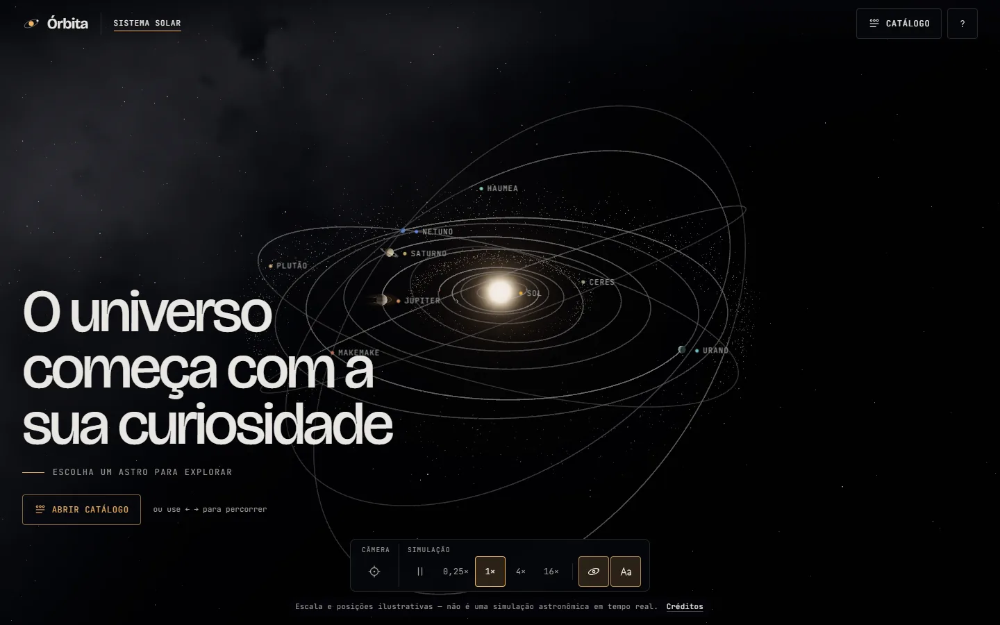
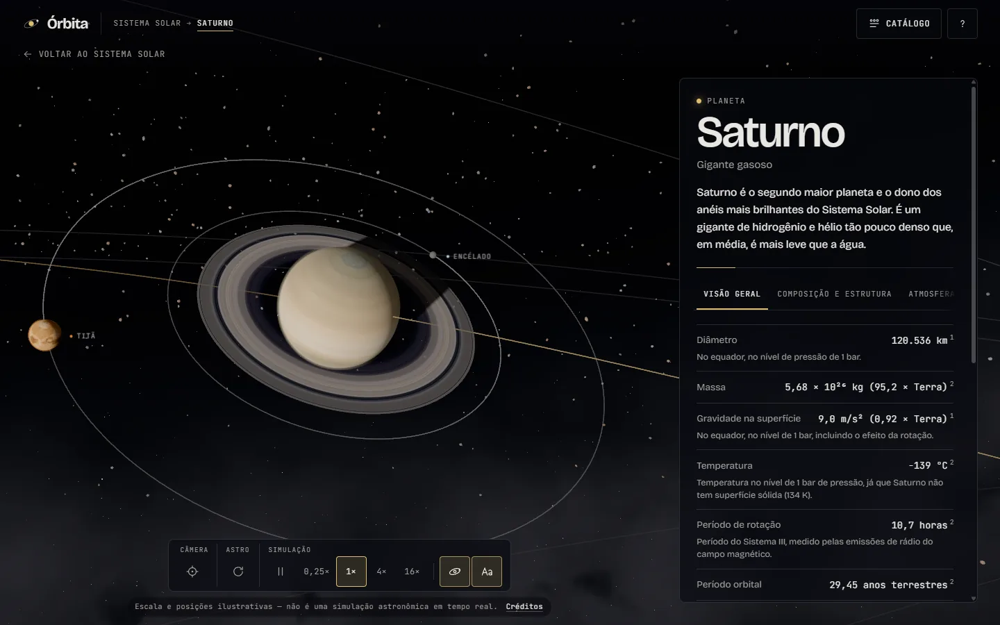
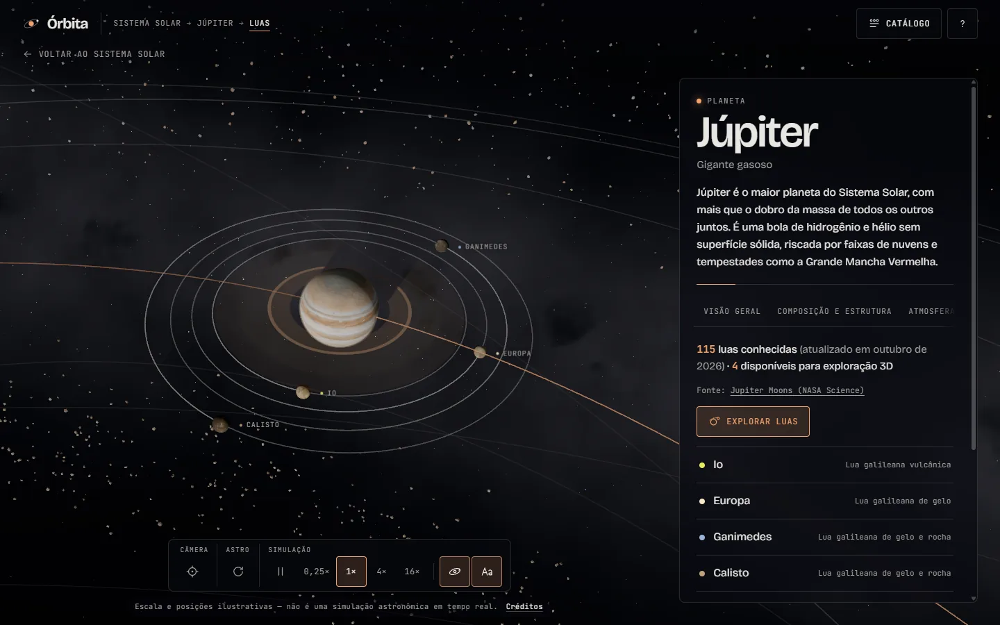
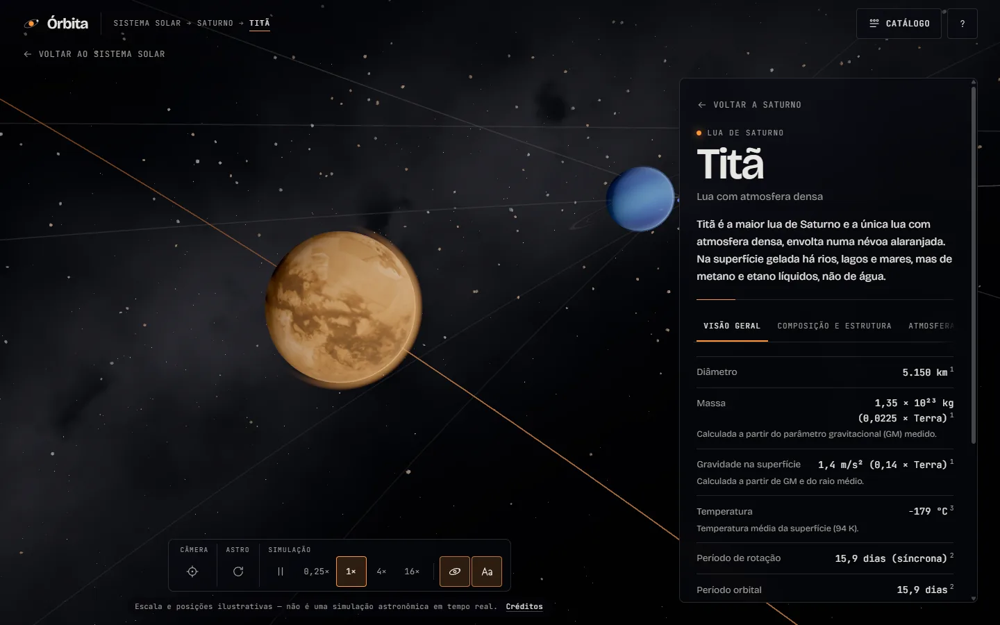
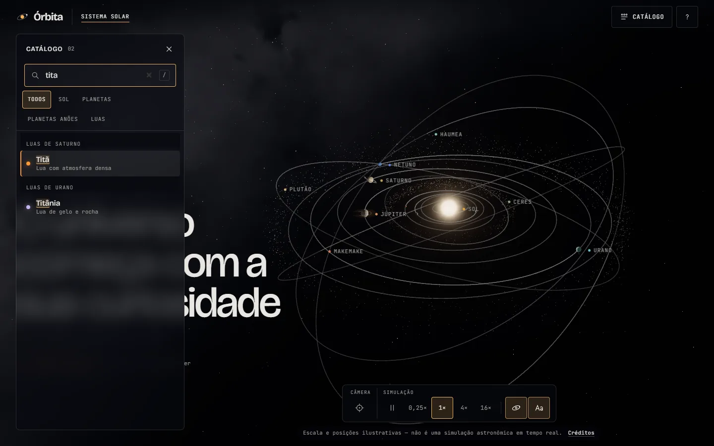
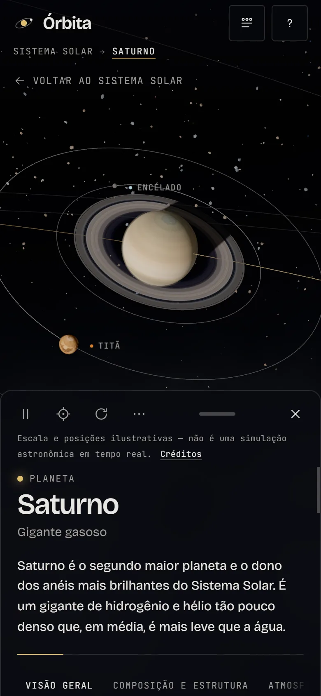
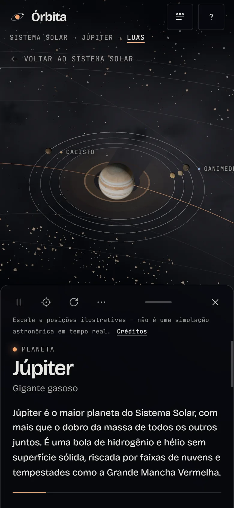

# Órbita — explorador 3D do Sistema Solar

O Órbita é um site interativo para explorar o Sistema Solar em 3D: o Sol, os 8 planetas, 5 planetas anões e 13 luas, cada um com dados científicos citados, fontes e data de atualização. O objetivo é unir uma cena 3D bonita e fluida a informação confiável, com uma interface discreta que funciona por mouse, toque e teclado.

Projeto desenvolvido por Matheus Lopes com ajuda de IA (Claude Code).

**Demonstração:** ainda não há versão publicada. Para rodar localmente, veja [Como executar](#como-executar).



## Imagens

| Planeta selecionado                                                  | Exploração das luas                                                                    |
| -------------------------------------------------------------------- | -------------------------------------------------------------------------------------- |
|     |  |
| **Lua selecionada**                                                  | **Catálogo com busca sem acentos**                                                     |
|  |    |

<p align="center">
  
  &nbsp;
  
</p>

## Funcionalidades

- **Cena 3D** com Sol, planetas, planetas anões, luas, cinturão de asteroides, cinturão de Kuiper e campo de estrelas com parallax.
- **Movimento simulado**: órbitas elípticas e inclinadas, rotação axial (incluindo rotações retrógradas e luas em rotação síncrona), com pausa e velocidades de 0,25×, 1×, 4× e 16×.
- **Seleção de astros** por clique ou toque na cena, pelo catálogo ou pelas setas `←` `→`. Astros pequenos têm área de clique ampliada.
- **Navegação em níveis**: visão geral → astro → luas → lua, com trilha (`Sistema Solar → Saturno → Titã`), botão de voltar, `Esc` e o voltar do navegador.
- **Links diretos** por hash: `#/saturno`, `#/saturno/luas`, `#/saturno/tita`. Endereços inválidos voltam para `#/`.
- **Exploração das luas**: o painel mostra quantas luas o astro tem e quais podem ser exploradas em 3D; "Explorar luas" enquadra o sistema e permite selecionar cada lua.
- **Câmera com voos suaves** entre astros, que contornam planetas no caminho e enquadram o astro na área da tela que os painéis deixam livre.
- **Catálogo** com busca que ignora acentos ("tita" encontra "Titã") e filtros por tipo.
- **Painel de informações** com abas (só as que existem para cada astro), ficha técnica, fontes numeradas, data de atualização e selo de "representação artística" quando a aparência não vem de imagens reais.
- **Controles da cena**: pausar, restaurar câmera, pausar a rotação do astro, mostrar órbitas e nomes. Órbitas, nomes e velocidade ficam salvos no navegador.
- **Celular**: painel em bottom sheet arrastável com três alturas, com os controles dentro dele.
- **Acessibilidade**: tudo funciona pelo teclado, com atalhos, foco visível, anúncios para leitores de tela (`aria-live`) e respeito a `prefers-reduced-motion`.
- **Qualidade adaptativa**: a cena ajusta resolução, efeitos e quantidade de partículas conforme o desempenho do aparelho.
- **Modo sem WebGL**: catálogo com os mesmos dados, imagens estáticas e as mesmas URLs.
- **Modais de ajuda e créditos**, com a lista de texturas e fontes de dados.

### Atalhos

| Tecla           | Ação                                              |
| --------------- | ------------------------------------------------- |
| `Esc`           | Volta um nível (ou fecha menu, catálogo ou modal) |
| `Espaço`        | Pausa ou retoma a simulação                       |
| `←` `→`         | Astro anterior ou próximo                         |
| `R` · `O` · `N` | Restaurar câmera · órbitas · nomes                |
| `/`             | Buscar no catálogo                                |
| `?`             | Ajuda                                             |

Os atalhos ficam desligados enquanto o foco está num campo de texto.

## Tecnologias

- [React 19](https://react.dev/) e [TypeScript 5.9](https://www.typescriptlang.org/) (modo strict)
- [three.js 0.186](https://threejs.org/), [React Three Fiber 9](https://r3f.docs.pmnd.rs/), [Drei 10](https://drei.docs.pmnd.rs/) e [postprocessing](https://github.com/pmndrs/postprocessing) (bloom)
- Shaders GLSL próprios para o Sol, a Terra, atmosferas, anéis e superfícies procedurais
- [Zustand 5](https://zustand.docs.pmnd.rs/) para o estado global
- [Vite 8](https://vite.dev/) para desenvolvimento e build
- [Vitest](https://vitest.dev/), Testing Library e jsdom para testes; [Zod](https://zod.dev/) para validar os dados nos testes
- ESLint (TypeScript, React Hooks, jsx-a11y) e Prettier
- [sharp](https://sharp.pixelplumbing.com/) no script que gera as texturas
- CSS puro com variáveis (tokens) e fontes self-hosted via Fontsource

## Como executar

### Requisitos

- **Node.js 22.18 ou mais novo** (definido em `engines` no `package.json`)
- npm (vem com o Node)
- Navegador com WebGL 2 para a cena 3D; sem WebGL, o site abre no modo catálogo

### Instalação e execução

```bash
git clone https://github.com/m4thh3us-netizen/orbita-sistema-solar.git
```

```bash
cd orbita-sistema-solar
```

```bash
npm ci
```

```bash
npm run dev
```

Abra <http://localhost:5173>. O `npm ci` instala exatamente as versões do `package-lock.json`. As texturas já estão no repositório, em `public/textures/`; não é preciso baixá-las.

Para ver o modo sem WebGL num navegador que tem WebGL, abra <http://localhost:5173/?sem-3d>.

### Build e verificações

| Comando                   | O que faz                                                         |
| ------------------------- | ----------------------------------------------------------------- |
| `npm run dev`             | Servidor de desenvolvimento (Vite)                                |
| `npm run build`           | Checagem de tipos (`tsc -b`) e build de produção em `dist/`       |
| `npm run preview`         | Serve o build de produção em <http://localhost:4173>              |
| `npm run typecheck`       | Checagem de tipos do TypeScript em todo o projeto                 |
| `npm run lint`            | ESLint                                                            |
| `npm test`                | Todos os testes (Vitest): interface, estado, cena, câmera e dados |
| `npm run test:watch`      | Testes em modo observação                                         |
| `npm run validar-dados`   | Só os testes de consistência dos dados científicos                |
| `npm run format`          | Formata o código com Prettier                                     |
| `npm run baixar-texturas` | Baixa, converte e gera as texturas (veja abaixo)                  |

O script de texturas só é necessário para refazer ou adicionar texturas. Ele lê o manifesto `src/data/texturas.ts`, grava em `public/textures/<astro>/<tipo>.webp` (2K) e `<tipo>-1k.webp` (1K) e guarda os originais em `.cache/texturas-originais/`, que fica fora do git:

```bash
npm run baixar-texturas -- --somente=terra,lua
```

Opções: `--somente=<ids>` limita aos astros indicados, `--forcar` refaz o que já existe e `--sem-download` gera só as texturas procedurais.

## Organização do código

```
src/
  App.tsx          detecta WebGL e monta cena + interface, ou o modo catálogo
  main.tsx         fontes, estilos e sincronizações (URL, preferências, movimento reduzido)
  scene/           cena 3D: canvas, astros, órbitas, escalas, cinturões, rótulos, qualidade
    materiais/     shaders GLSL (Sol, Terra, atmosfera, anéis, superfícies)
  camera/          controle da câmera, voos, enquadramento e transições
  assets/          carregamento, cache e liberação de texturas
  data/            astros tipados, fontes, créditos, formatação pt-BR e manifesto de texturas
  state/           store (Zustand), sincronização com a URL, preferências e navegação
  ui/              interface HTML: topo, catálogo, painel, rodapé, modais, atalhos e tokens CSS
  fallback/        modo catálogo sem WebGL
scripts/           geração das texturas
public/textures/   texturas em WebP (2K e 1K)
docs/              decisões técnicas, documentação dos dados e imagens do README
```

A cena e a interface não se chamam diretamente: as duas leem e escrevem no mesmo store (`src/state/store.ts`) e leem os astros por `src/data/index.ts`. A URL é sincronizada com o store nos dois sentidos.

```
                     ┌──────────────────────┐
  URL (#/saturno) ⇄  │  useOrbita (Zustand) │  ⇄  localStorage (órbitas, nomes, velocidade)
                     └─────────┬────────────┘
             lê/escreve        │        lê/escreve
        ┌──────────────────────┴──────────────────────┐
  OrbitaCanvas (cena)                          Interface (HTML)
        └──────────── src/data (bodies, getBody, getChildren, getAncestors) ────────┘
```

## Principais decisões técnicas

- **Dados separados da apresentação.** Cada astro é um objeto tipado em `src/data/`, com valores reais, fonte por dado e data de atualização. Catálogo, filtros, trilha, URL, abas, aba Luas e modo sem WebGL são gerados a partir desses dados, sem ids fixos no código da interface.
- **Escalas ilustrativas.** Tamanhos, distâncias e tempos reais não caberiam juntos na tela. Raios usam raiz quadrada, distâncias ao Sol usam escala logarítmica e períodos são comprimidos, preservando a ordem dos astros. As fórmulas estão em `src/scene/escala.ts` e são testadas.
- **Hash routing.** Links diretos funcionam em qualquer hospedagem estática, sem regras de reescrita. A URL é lida antes do primeiro render, então um link já abre no astro certo.
- **Câmera.** Voos por interpolação de Hermite partindo da posição e da velocidade atuais (uma nova seleção no meio do voo não dá tranco) e desvio de astros no caminho. Cada painel mede a área que ocupa e a câmera desloca a projeção (`setViewOffset`) para centralizar o astro na área livre.
- **Desempenho.** Texturas 1K carregam primeiro; a versão de alta resolução só é carregada para o astro selecionado e é liberada da GPU depois de 20 s sem uso. Um `PerformanceMonitor` sobe ou desce o nível de qualidade. three.js, React Three Fiber e React ficam em chunks próprios; ajuda, créditos e o modo sem WebGL carregam sob demanda.
- **Bloom seletivo.** Só o Sol passa do limiar de luminância, com tone mapping AgX depois do bloom.
- **Validação dos dados nos testes.** Um esquema Zod e testes conferem a consistência dos dados, incluindo a 3ª lei de Kepler para todas as órbitas, o contraste das cores de destaque e a correspondência entre texturas e créditos.
- **Acessibilidade desde o início.** `<dialog>` nativo para modais (foco preso e devolvido), padrões ARIA de combobox, listbox e abas, e movimento reduzido acompanhado ao vivo.

As decisões completas estão em [`docs/decisoes-cena.md`](docs/decisoes-cena.md), [`docs/decisoes-interface.md`](docs/decisoes-interface.md), [`docs/decisoes-dados.md`](docs/decisoes-dados.md) e [`docs/integracao.md`](docs/integracao.md). A metodologia e as convenções dos dados estão em [`docs/dados.md`](docs/dados.md).

## Limitações conhecidas

- **Escalas e posições ilustrativas.** Tamanhos, distâncias e velocidades não estão em proporção real. Os dados não incluem nodo ascendente, argumento do periapse nem posição inicial, então esses ângulos são sorteados de forma determinística: a posição dos astros na tela não corresponde à data real.
- **Só 13 luas em 3D.** O painel mostra a contagem de luas conhecidas, mas apenas as luas principais podem ser exploradas.
- **Aparências parcialmente artísticas.** Astros sem mapa global público usam texturas ilustrativas (Haumea, Makemake e Éris) ou geradas pelo projeto (Deimos, Titânia e Oberon), e Tritão tem a área não fotografada preenchida com a cor média. Esses astros exibem o selo "Representação artística". Os anéis de Júpiter, Urano, Netuno e Haumea são gerados a partir dos raios publicados.
- **Efeitos não implementados**: sombra dos anéis sobre o planeta; o mapa normal da Terra está no repositório, mas não é usado.
- **Valores pendentes de conferência.** Alguns valores de Fobos, Haumea e Éris vêm de artigos que não foram abertos na verificação; a lista está em [`docs/dados.md`](docs/dados.md#pendências-de-verificação-humana).
- **Não verificado em condições reais**: uso com leitor de tela (NVDA/VoiceOver), toque em aparelho físico, perda de contexto WebGL e troca automática de qualidade.
- **Sem testes de ponta a ponta automatizados**; os testes cobrem unidades e componentes.
- **Tamanho do bundle**: o chunk do three.js tem cerca de 870 kB (227 kB com gzip).
- Interface apenas em português.

## Deploy

O build é estático (`dist/`) e usa rotas por hash, então não precisa de regras de reescrita.

- **Vercel**: importe o repositório; o preset Vite usa `npm run build` e `dist`. Em _Settings → General → Node.js Version_, escolha 22.x ou mais novo.
- **Netlify**: build command `npm run build`, publish directory `dist`, variável `NODE_VERSION=22`.
- **Subpasta** (por exemplo, GitHub Pages em `/orbita-sistema-solar/`): `npm run build -- --base=/orbita-sistema-solar/`. Texturas e fontes usam `import.meta.env.BASE_URL`.

## Fontes dos dados científicos

Cada astro lista suas fontes no campo `fontes`, e o catálogo completo, com URL e data de acesso, está em `src/data/fontes.ts`. A ordem de preferência foi:

1. [NASA NSSDCA — Planetary Fact Sheets](https://nssdc.gsfc.nasa.gov/planetary/factsheet/): valores físicos e orbitais de planetas, Lua, Plutão e Sol, atmosferas e anéis.
2. [NASA/JPL — Solar System Dynamics](https://ssd.jpl.nasa.gov/): parâmetros físicos e elementos orbitais dos satélites e, pelo Small-Body Database, dos planetas anões.
3. [NASA Science](https://science.nasa.gov/solar-system/): contagem de luas, descrições e curiosidades.
4. Artigos científicos, só quando as fontes anteriores não cobrem o dado: Ortiz et al. (2017), Ragozzine & Brown (2009), Sicardy et al. (2011), Brown & Schaller (2007), Szakáts et al. (2023), Bernstein et al. (2023) e MGS/TES (1998).

Valores derivados (como massa a partir do parâmetro gravitacional GM) são indicados na nota do dado. A metodologia, as divergências entre fontes e os valores omitidos estão em [`docs/dados.md`](docs/dados.md).

## Créditos

- **Texturas**: [Solar System Scope](https://www.solarsystemscope.com/textures/) / INOVE, baseadas em dados da NASA (CC BY 4.0), e mosaicos da NASA, JPL-Caltech e USGS Astrogeology (domínio público). Algumas texturas (Deimos, Titânia, Oberon e os anéis de Júpiter, Urano, Netuno e Haumea) são geradas pelo próprio projeto. A lista completa, com autor, licença, URL de origem e modificações de cada arquivo, está em [`CREDITS.md`](CREDITS.md) e no modal "Créditos" do site.
- **Ruído simplex** em GLSL: Ian McEwan e Stefan Gustavson, Ashima Arts ([webgl-noise](https://github.com/ashima/webgl-noise), licença MIT).
- **Tipografia** self-hosted via Fontsource: [Bricolage Grotesque](https://github.com/ateliertriay/bricolage), de Mathieu Triay, e [JetBrains Mono](https://github.com/JetBrains/JetBrainsMono), da JetBrains, ambas sob a SIL Open Font License 1.1.
